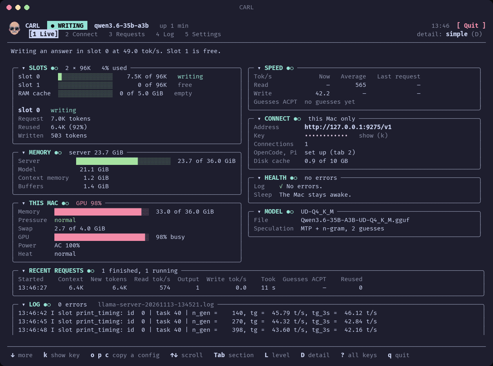
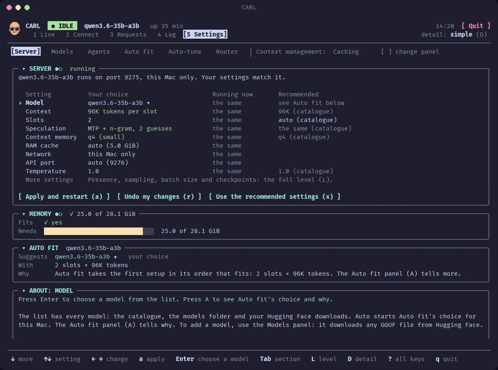
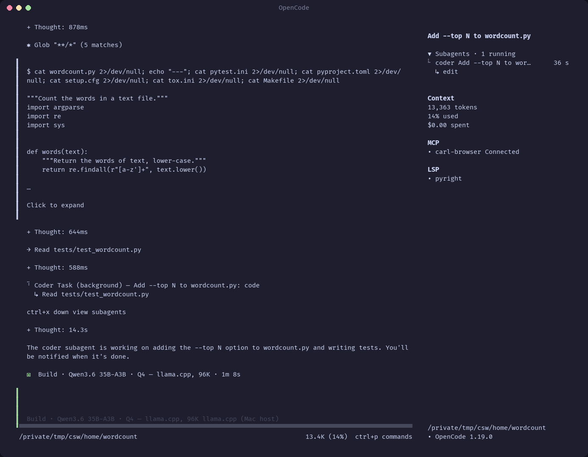

<p align="center"></p>

<h1 align="center">CARL</h1>

<h3 align="center"><b>C</b>an't <b>A</b>fford <b>R</b>emote <b>L</b>LMs</h3>

<p align="center"><i>AI Slop Coded LLM Runner, So You Can Code AI Slop Locally</i></p>

<p align="center">A local coding model runner for <b>OpenCode</b> and <b>Pi</b>, on your Apple Silicon Mac<br>
or on a Windows or Linux PC with an NVIDIA GPU. One command starts the server and a live dashboard.</p>

---

## Install

**Tested on:** an Apple Silicon Mac, and a PC with an NVIDIA GeForce RTX 2070 SUPER (8 GB) on Windows 11 and in WSL (Ubuntu 24.04). Other GPUs and Linux outside WSL may work, but are not tested: [Windows and Linux](reference/windows-linux.md). Each model needs 4.6–23 GB of free disk space.

Get the CARL folder. In it, make the command `carl` with [uv](https://docs.astral.sh/uv/) (`uv tool install --editable .`), or run `python3 carl.py` (on Windows `py carl.py`) in the folder in place of `carl`. The install is editable: when you update the CARL folder, the command is up to date. CARL has no other dependencies.

### Mac (Apple Silicon)

**You need:** [Homebrew](https://brew.sh) and `python3`.

```bash
uv tool install --editable .     # in the CARL folder: the command carl, for every folder
brew install llama.cpp aria2 ansifilter zstd
carl download default            # the best model for this Mac (resumable, checksum-verified)
carl install                     # OpenCode + Pi into ~/.local (no sudo), connected to the server
```

- If you skip the `brew install`, `carl` finds the missing tools and asks to install them.
- If you skip the download, `carl` asks to download the best model for this Mac.
- `carl install` asks one time which clients (OpenCode, Pi or both) and which options you want (the coder, the browser, web search, LSP). `--yes` takes the defaults.
- **Your own OpenCode and Pi settings stay.** The setup adds CARL next to them. It keeps a backup of each file that it changes (`FILE.before-carl`, the original, and one `FILE.bak`, the version before CARL's last change).

### Windows 11 (NVIDIA GPU)

**You need:** Python 3.9 or newer (from python.org, or `uv`), the NVIDIA driver, and Windows Terminal. No compiler, no admin rights.

```powershell
uv tool install --editable .     # in the CARL folder; uv tool update-shell puts carl on the path
carl engine install              # the llama.cpp build that CARL is tested with (CUDA 13 or 12), checked
carl download default            # the best model for the free memory of your GPU
carl install                     # OpenCode + Pi for this user (no admin), connected to the server
```

- `carl install` asks one time which clients and options you want, as on a Mac. It puts OpenCode and Pi in `%USERPROFILE%\.local` and adds that folder to your Path: open a new terminal after it.
- For another Windows computer, `carl package --anyway` makes the client package (`dist\carl-client-VERSION-HOST.zip`). Unzip it there and run `setup.cmd` in its `carl-client` folder.
- `carl gpu` shows your GPU and its free memory. `carl fit` shows the model that fits and why.

### Linux (NVIDIA GPU)

**You need:** Python 3.9 or newer and the NVIDIA driver. No compiler, no sudo.

```bash
uv tool install --editable .     # in the CARL folder
carl engine install              # the llama.cpp build that CARL is tested with (CUDA 13 or 12), checked
carl download default            # the best model for the free memory of your GPU
carl install                     # OpenCode + Pi for this user (no sudo), connected to the server
```

- The client sync service runs with `systemd --user`. `loginctl enable-linger $USER` keeps it running after you log out.
- More for both PCs (where the files are, the GPU's own memory, the llama.cpp builds): [reference/windows-linux.md](reference/windows-linux.md).

### Another computer or a VM

Clients on another computer (macOS or Linux): start the server for that network (for example `carl --vm` for a VM on the Mac), then make the client package and run its setup there:

```bash
carl package                     # on the server: dist/carl-client-VERSION-HOST.zip
unzip carl-client-*.zip && cd carl-client && ./setup      # on the other computer
```

- The zip holds the server's API key: keep it secret, and delete it after the copy.
- **The server serves this computer only** (127.0.0.1) by default. Then `package` makes no zip and tells you how to change the network. More: [Clients in the VM](USERGUIDE.md#clients-in-the-vm), [Clients on another computer](USERGUIDE.md#clients-on-another-computer-or-another-vm-app), [The client package](USERGUIDE.md#the-client-package).

## Use

```bash
carl                              # start the server and the dashboard
```

Then, in a second terminal, go to your project folder and start `opencode` or `pi` there. They work on the folder that you start them in.

```bash
cd ~/path/to/your/project
opencode
```

- **The first time,** CARL starts the model that **Auto fit** chooses for your computer: the best stock model that holds two slots of 96K tokens (or the next setup of its order, down to 48K; two slots of 128K tokens on a PC with an NVIDIA GPU). `carl fit` shows the choice and why.
- **The next time,** it starts llama.cpp with the settings that you saved.
- **If a server runs already,** the dashboard attaches to it.
- `carl -h` shows all commands. `carl help COMMAND` (or `carl COMMAND --help`) shows the help for one command.

## Models

| Model | For |
|---|---|
| `qwen3.6-35b-a3b` | The default: fast MoE, everyday agent coding (32 GB+) |
| `qwen3.8-27b` | The dense 27B: hard code, slower (32 GB+) |
| IQ3 and Q3 builds | 24 GB Macs |
| `gemma-4-e4b`, `gemma-4-12b`, `saluki-27b` | 16 GB Macs: the E4B is fast, the 12B is better at code, Saluki (a 2-bit 27B) keeps a coder subagent |
| `orcarouter-27b…`, `heretic-35b-a3b…` | Abliterated (uncensored) builds |
| `gemma-4-26b-a4b`, `gemma-4-31b` | Google's larger Gemma 4 models (32 GB+) |
| `qwen3.8-9b` | A small distilled Qwen, for more subagents at the same time |

- `carl models` lists the catalogue and each `.gguf` in `~/models/gguf`. Each model has a folder of its own there, with a folder for each quantization (`~/models/gguf/MODEL/QUANT/FILE.gguf`); a file directly in the folder works too. A model with several quantizations is listed once; `carl start --model NAME --quant Q` takes one. CARL reads no other folder of `~/models/gguf` (your own, `r4/`), and lists no GGUF file that is not a language model.
- `carl download hf:OWNER/REPO/FILE.gguf` gets any GGUF from Hugging Face.
- `carl tune NAME` measures the best settings for a model on your computer.
- More: [Choosing a model](USERGUIDE.md#3-choosing-a-model), [Router mode](USERGUIDE.md#router-mode-switch-models-from-opencode-or-pi) (OpenCode and Pi change the model).

## The dashboard

The live state of the server and the computer: what the server does now, the slots, the speed, the memory, this computer (memory pressure, swap, GPU, power, heat), the requests and the log.



- **Tabs:** Live, Connect (install the clients, make the client package, send their config), Requests, Log, Settings.
- **Settings (tab 5):** seven panels: Server, Models, Agents, Auto fit, Auto-tune, Router, Caching. Push `[` or `]` to change the panel.
- **Levels:** each section of a screen has its own level: collapsed, simple or full. Push Tab to select a section and `L` to change its level, or click its title. Push `D` to set every section to simple or full. The dashboard keeps your choice.
- Every tab scrolls as one page. The footer shows the keys of the screen that you see. `?` shows all keys of that screen.
- More: [The dashboard](USERGUIDE.md#10-the-dashboard).



## In OpenCode and Pi

- **Model:** `/models` in OpenCode, `/model` in Pi.
- **Thinking:** `/variants` (or ctrl+t) in OpenCode, the thinking level in Pi ([Thinking](USERGUIDE.md#4-thinking-on-off-and-effort)).
- **The coder:** large tasks go to a coder subagent in the background. Type `@coder TASK` in OpenCode to ask for it.
- **Tools:** web search, LSP, a browser subagent, background subagents ([Tools](USERGUIDE.md#tools-in-opencode-and-pi)). Web search sends the queries to Exa: answer `off` in the setup (or `carl install --web-search off`) to turn it off.

## Plugins



The setup (`carl install`, or `./setup` on another computer) adds CARL's plugins to OpenCode and Pi:

- **Disk cache:** fast starts; sessions come back after a restart (OpenCode, Pi).
- **Coder subagent, in the background:** large tasks go to a specialist coder while the main session stays free (OpenCode, Pi).
- **Subagents panel** and **session switcher** in OpenCode's sidebar and prompt box.
- **Model check:** a warning when the model that you select is not the one that the server runs (OpenCode, Pi).
- **`/carl`:** a control panel: turn each CARL piece on or off; the config sync (OpenCode, Pi).
- **Speeds:** the server's read and write speed in OpenCode's sidebar and Pi's status line, while the dashboard runs.

What each one does and how to turn it off: [USERGUIDE.md, "CARL's plugins and extensions"](USERGUIDE.md#carls-plugins-and-extensions). How they work: [reference/plugins.md](reference/plugins.md).

## Read more

- [USERGUIDE.md](USERGUIDE.md): setup, daily use, models, thinking levels, the dashboard, troubleshooting.
- [reference/](reference/README.md): how it works, the caches, measurements, the files in this folder, and the design decisions.
- [CHANGELOG.md](CHANGELOG.md): what changed in each release.
